# LocalCart

**Order from the shops on your street, by chat.**

In India, people already order from the neighbourhood kirana on WhatsApp: "bhaiya, 2 kg aloo, 1 litre
Amul milk, 5 eggs". It works, but it's unstructured. The shopkeeper retypes the list, guesses prices,
loses track of who paid, and the customer never knows when it will arrive.

LocalCart keeps the chat and adds structure. A customer types or speaks their list in Hindi or English.
AI turns it into a cart matched to that shop's catalog. The shop confirms availability and prices with
a bill in one tap. The customer pays cash on delivery or by UPI, and a live order card in the chat moves
from Accepted to Packed to Out for delivery to Delivered on both phones.

- **Android app (APK, signed release, 25 MB):** https://8eiqfkaqqyue5xri.public.blob.vercel-storage.com/localcart/releases/LocalCart-1.0.0.apk
- **Backend:** https://localcart-api.vercel.app (`/api/health`)
- **GitHub release:** https://github.com/imthegoodboy/localcart/releases/tag/v1.0.0

Real screenshots from the signed release build on an Android 16 emulator, against the production
backend. The other phone in each flow was driven through the same API and the Nexconn Platform API.

| Find a shop | Shop page | AI cart from a Hinglish message |
| --- | --- | --- |
| 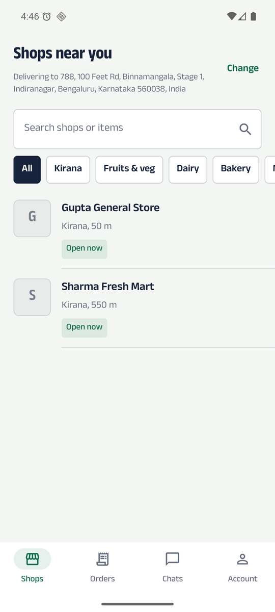 | 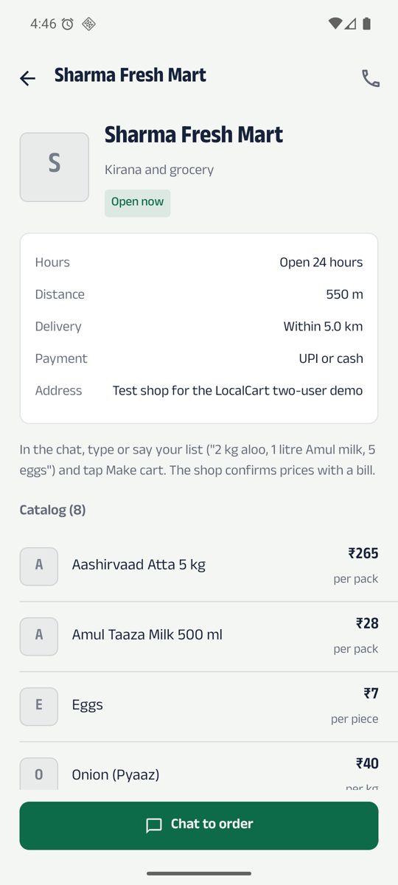 | 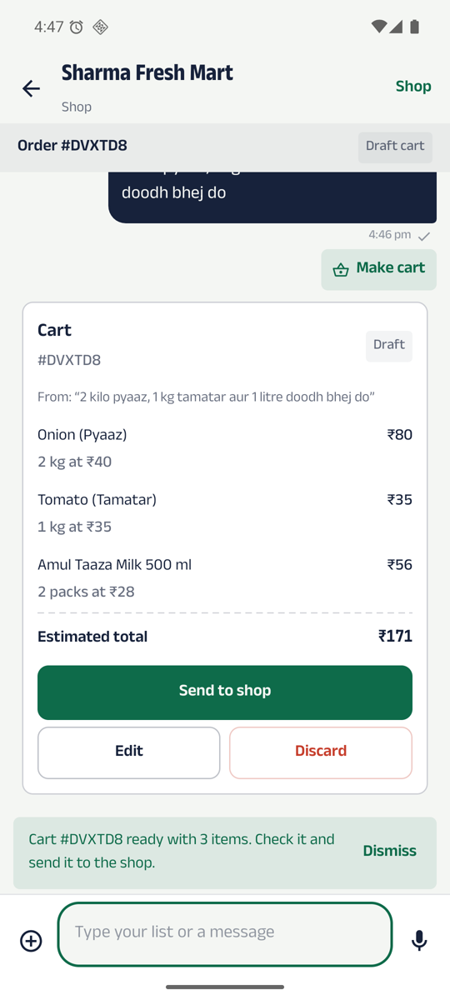 |

| Shop: cart arrives live | Shop: prepare the bill | Customer: bill arrives |
| --- | --- | --- |
| 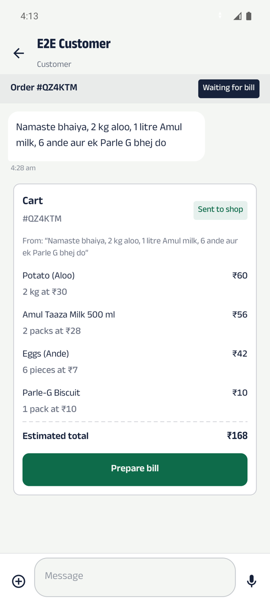 | 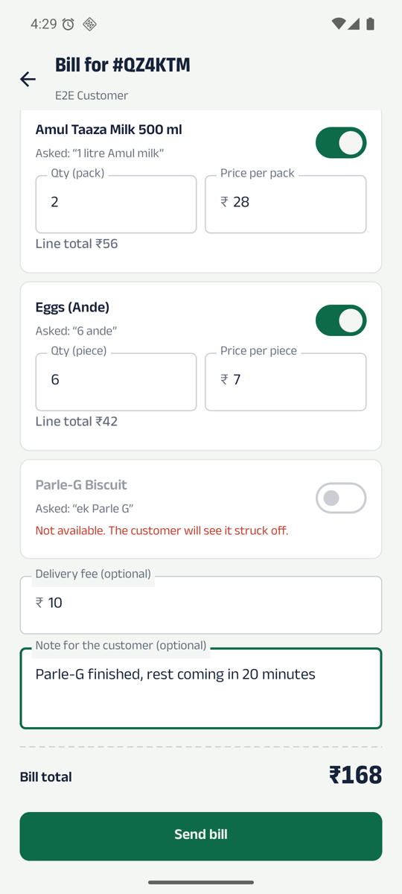 | 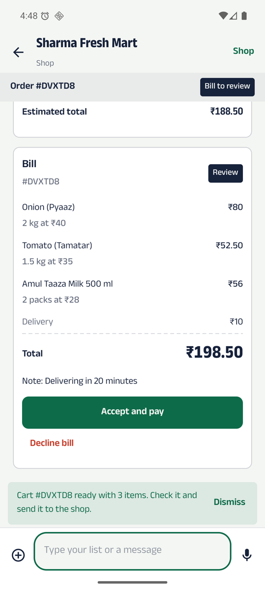 |

| UPI intent (no UPI app on the emulator) | Status card updates in place | Delivered and rated |
| --- | --- | --- |
| 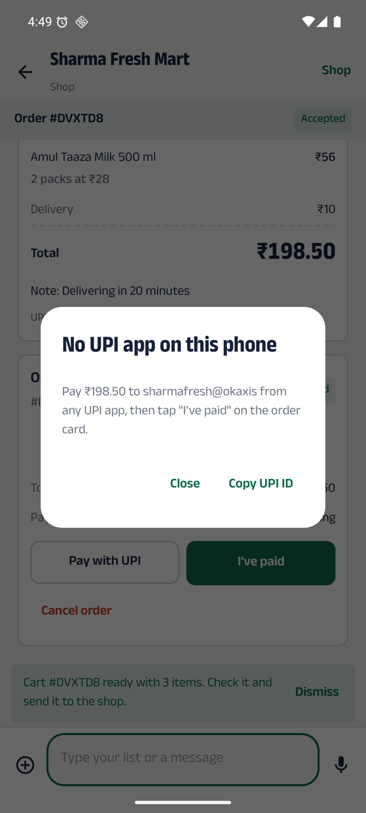 | 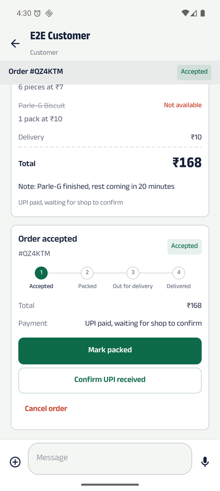 | 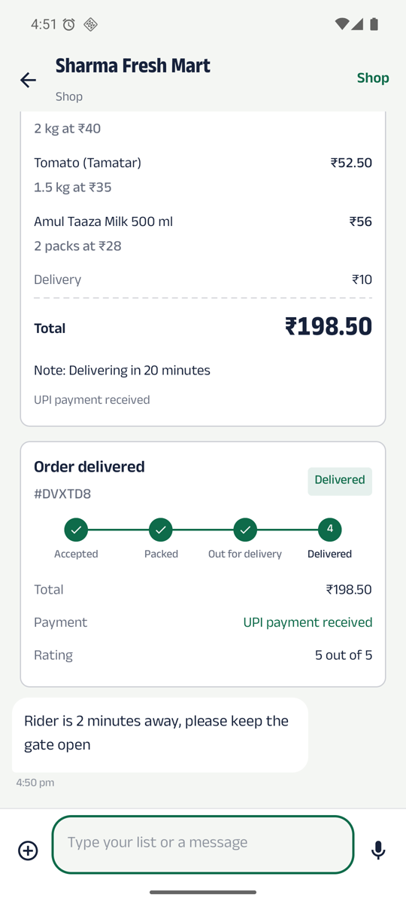 |

| Shop dashboard updating live | Location and HD voice messages |
| --- | --- |
| 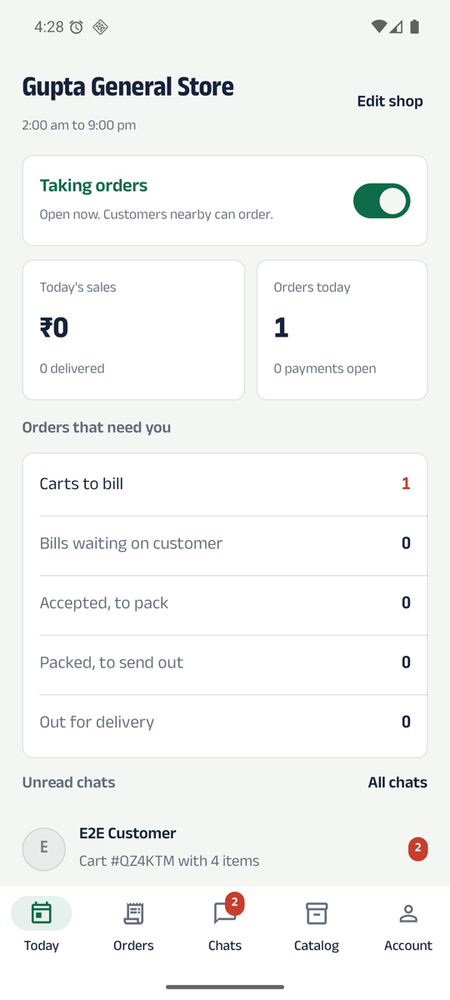 | 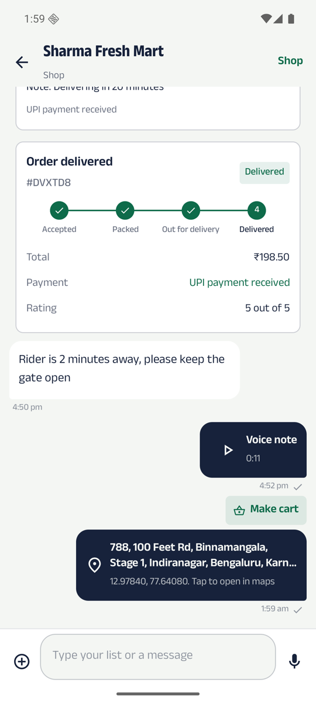 |

## Features

**Customers**
- Sign up with a mobile number, share GPS location or type an address.
- Nearby shops sorted by distance, open ones first, with category filters and search by shop or item.
- Shop page with catalog, prices, stock, hours, delivery radius, rating and a call button.
- Chat to order: type a list or record a voice note, tap **Make cart**, and a Cart card appears with
  catalog-matched items, quantities in the right units, prices and a total. Unmatched items stay on the
  cart for the shop to price.
- Edit the cart (quantities by unit step, remove lines, add from the catalog) until the shop bills it.
- Accept the shop's Bill card and pay **cash on delivery** or **UPI** (a real `upi://pay` intent to the
  shop's UPI ID with the exact amount), then tap **I've paid**.
- Live Order status card, delivery location sharing, order history with one-tap reorder, shop ratings.

**Shopkeepers**
- Set up the shop: photo (camera or gallery, uploaded to Vercel Blob), GPS pin, delivery radius, opening
  hours, UPI ID, open/closed switch.
- Catalog with photos, units, prices and in-stock toggles; paste or type a price list and AI turns it
  into items to review.
- Dashboard: open switch, today's sales, orders by status, unread chats. It updates live as carts arrive.
- Bill editor: availability, quantity and price per line, delivery fee, note. Then Packed, Out for
  delivery, Delivered, payment confirmation, or cancel with a reason.

**Chat everywhere**: text, photos, HD voice notes and locations, typing indicators, read receipts,
unread badges, conversation list, offline history, failed-send retry, and in-app notifications.

## How this uses Nexconn

LocalCart is built on the **Nexconn Android Chat SDK** (`ai.nexconn.chat:chat:26.4.2`) and the
**Nexconn Platform Chat API**, Singapore data centre.

| Nexconn feature | How LocalCart uses it | Code |
| --- | --- | --- |
| `NCEngine.initialize` with `AreaCode.SG` | SDK set up once per process with the App Key served by our backend | `android/.../chat/NexconnChat.kt` |
| `NCEngine.connect` + connection status handler | Connects after sign-in with a server-issued token; refreshes the token on 31004/31020/`TOKEN_INCORRECT`; shows connecting/offline/kicked states | `NexconnChat.kt`, `ui/chat/ChatScreen.kt` |
| Direct channels | One channel per customer and shop pair | `DirectChannel(peerId)` |
| Text messages | Everyday chat, and the typed order the AI reads | `NexconnChat.sendText()` |
| HD voice messages | Spoken orders (AAC, 44.1 kHz), playable by the shop; the same file is sent to Gemini for the cart | `media/Media.kt`, `NexconnChat.sendVoice()` |
| Image messages | Product photos in chat, with upload progress | `NexconnChat.sendImage()` |
| Location messages (`RC:LBSMsg`) | Customers share where to deliver; also saved on the active order. SDK 26.4.2 rejects client-side `LocationMessage` sends with an undocumented 31610, so the server sends the same built-in type through the Platform API as the user; both phones receive and render it through the SDK | `NexconnChat.sendLocation()`, `server/src/routes/chat.ts` |
| **Custom message types** | `lcr:cart`, `lcr:bill`, `lcr:status` cards, registered with `registerCustomMessages` | `chat/CardMessages.kt` |
| **Message metadata** | Live card state (status, payment, cart revision, cancel reason, rating) set by the server on every order change; both phones re-render via `onMessageMetadataUpdated` | `server/src/services/orders.ts`, `ui/chat/ChatViewModel.kt` |
| **Message update** | Editing a cart replaces the original Cart card's content for both sides (`onMessagesUpdated`) | `server/src/nexconn/client.ts` |
| Read receipts | `needReceipt` on sends, `sendReadReceiptResponse` when seen, ticks from `onMessageReceiptResponse` and `getMessageReadReceiptInfo` | `NexconnChat.markRead()` |
| Typing indicators | `sendTypingStatus` while composing; "typing…" in the chat header | `NexconnChat.sendTyping()` |
| Unread counts | Per-channel badges, total badge on the Chats tab, unread chats on the shop dashboard; `clearUnreadCount` on open | `NexconnChat.refreshUnread()` |
| Conversation list | `createChannelsQuery`, resolved to shop and customer names through our API | `ui/chat/ChatListScreen.kt` |
| History pagination | `createMessagesQuery` pages older messages from the local database as you scroll | `ChatViewModel.loadMore()` |
| Platform Chat API | Token issue (`/v4/auth/access-token/issue`), user info (`/v4/user/update`), server-sent cards (`/v4/direct-channel/message/send` with `hasMetadata` and `isEchoToSender`), metadata (`/v4/channel-type/message/metadata/set`), message update (`/v4/direct-channel/message/update`) | `server/src/nexconn/client.ts` |

Order state lives in Postgres and is the source of truth. The server posts the cards and moves their
state with message metadata, so a card always matches the order, and the app re-fetches the order
whenever a card is shown.

## Tech stack

- **Android**: Kotlin 2.2, Jetpack Compose (Material 3, custom theme), Navigation (type-safe routes),
  Retrofit + kotlinx.serialization, Coil, manual DI, Android Keystore (AES-GCM) for the session,
  minSdk 26, target/compile SDK 36, R8, signed release build.
- **Backend**: TypeScript (strict), Hono on Vercel, Drizzle ORM on Neon Postgres (Singapore), zod,
  bcrypt + JWT, Vercel Blob, Gemini via `@google/genai` (structured JSON, model fallback, retries).
- **Design**: four colours (paper, ink, leaf green, chilli red), no gradients; Anek Devanagari, an
  Indian multi-script typeface, so Hindi transcripts and English share one face; Cart and Bill cards
  drawn like bill slips with tabular rupee figures.

## Setup

### Backend

```bash
cd server
npm install
vercel env pull .env.local --yes   # or copy .env.example and fill it in
npm run db:migrate
npm run dev                        # http://localhost:3106
npm test
```

### Android

```bash
cd android
./gradlew :app:assembleDebug                                        # talks to production
./gradlew :app:assembleDebug -Plocalcart.apiBaseUrl=http://10.0.2.2:3106/   # local backend
./gradlew :app:testDebugUnitTest
```

### Release signing

The release keystore is not in git. To create one:

```bash
cd android
keytool -genkeypair -v -keystore localcart-release.jks -alias localcart -keyalg RSA -keysize 2048 \
  -validity 10000 -dname "CN=LocalCart, O=LocalCart, C=IN"
```

Then create `android/keystore.properties` (gitignored):

```properties
storeFile=localcart-release.jks
storePassword=<your password>
keyAlias=localcart
keyPassword=<your password>
```

and run `./gradlew :app:assembleRelease`. The APK is at `app/build/outputs/apk/release/app-release.apk`.
Keep the keystore safe: updates to an installed app must be signed with the same key.

## Limitations

- No FCM push yet (the shared Nexconn console has no FCM credentials). Alerts work in real time while
  the app is open or in the background; see AGENTS.md.
- UPI confirmation is manual (customer marks paid, shop confirms); there is no payment gateway.
- After a reinstall, older chat history is not re-downloaded; orders always load from the server.

More detail for contributors is in [AGENTS.md](AGENTS.md).
